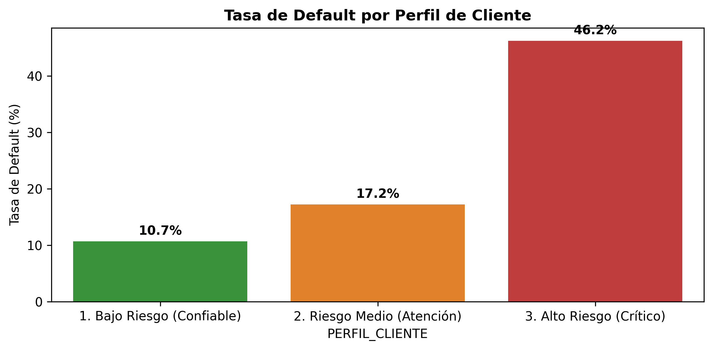
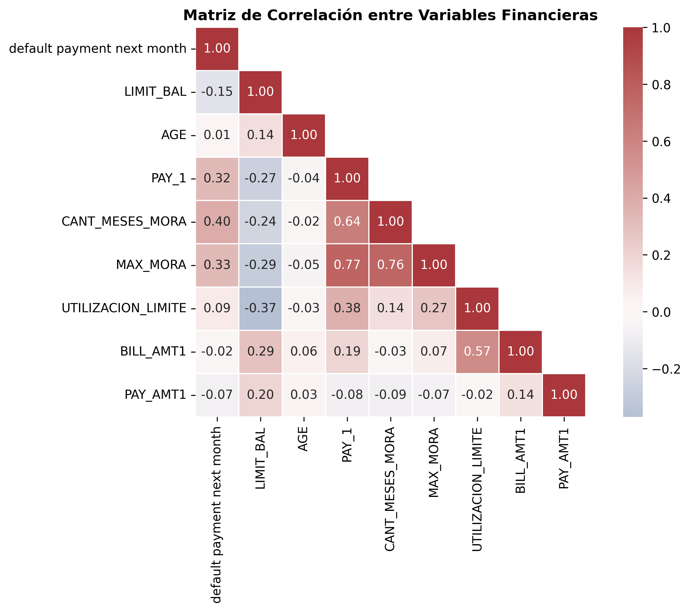
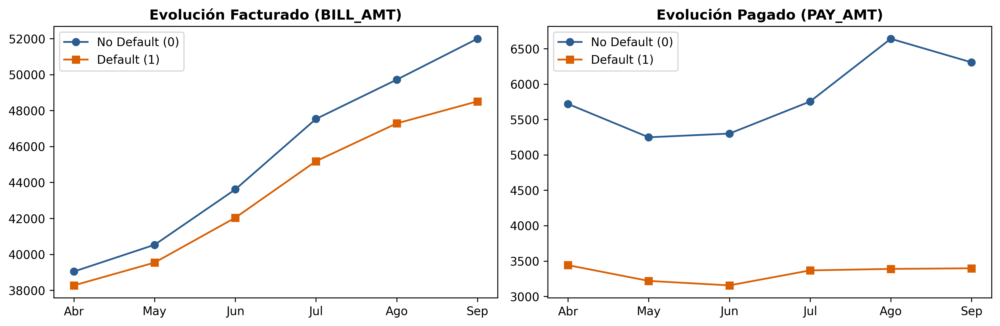
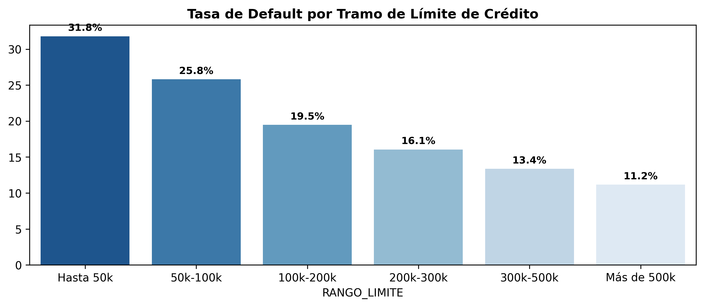

# Default-of-Credit-Card-Clients
Análisis exploratorio, ingeniería de variables y evaluación de riesgo crediticio para predicción de default en clientes bancarios de Taiwan
# 💳 Credit Card Default & Risk Analysis

Análisis exploratorio avanzado, ingeniería de características financieras y segmentación de riesgo crediticio sobre una cartera de **30.000 clientes bancarios**, orientado a identificar patrones tempranos de morosidad e impago (*default*).

---

## 1. Contexto y Problema de Negocio

El objetivo principal es modelar la probabilidad de que un cliente caiga en **default** en el mes siguiente. En la gestión de carteras de consumo, predecir el impago permite:
* Anticipar pérdidas crediticias y ajustar provisiones de capital.
* Segmentar la cartera para políticas diferenciadas (límites, beneficios o cobranza preventiva).
* Reducir el sesgo en la toma de decisiones crediticias.

> **Diagnóstico del Target (Desbalance de Clases):**  
> La tasa de default observada en la cartera es del **22,12% (6.636 clientes)** frente a un **77,88% (23.364 clientes)** que cumplieron puntualmente. Este desbalance exige evaluar los modelos predictivos mediante métricas robustas como **ROC-AUC, Precision y Recall**, evitando la métrica engañosa de exactitud (*accuracy* simple).

---

## 2. Ingeniería de Variables Financieras (Feature Engineering)

A partir de los registros brutos del banco, se diseñaron variables de comportamiento financiero agregado:

* **Tasa de Utilización del Límite (`UTILIZACION_LIMITE`):** `BILL_AMT1 / LIMIT_BAL`, midiendo el nivel de saturación de la línea de crédito sobre el cupo total.
* **Ratio de Cobertura de Pago (`RATIO_PAGO_1`):** `PAY_AMT1 / BILL_AMT2`, proporción del saldo adeudado del mes previo que fue efectivamente cancelada.
* **Historial Agregado de Retrasos (`CANT_MESES_MORA` y `MAX_MORA`):** Resumen de recurrencia y severidad de mora en la ventana temporal de 6 meses.
* **Segmentación de Perfiles de Riesgo (`PERFIL_CLIENTE`):** Clasificación en *Bajo*, *Medio* y *Alto Riesgo* basada en reglas de comportamiento financiero.

---

## 3. Hallazgos Principales y Análisis Exploratorio

### A. Segmentación por Perfil de Riesgo
La combinación de mora histórica y saturación de crédito logra separar la cartera con alta precisión:

  

* El segmento **Bajo Riesgo** registra una mora residual cercana al **10%**.
* El segmento **Alto Riesgo** escala a una tasa de default superior al **50%**.

---

### B. Matriz de Correlación y Recencia Temporal
El comportamiento reciente (`PAY_1`) y el acumulado de meses con mora (`CANT_MESES_MORA`) son los predictores con mayor asociación lineal positiva con el impago:

  

---

### C. Alerta Temprana: Evolución de Facturación vs Pagos
Al analizar la trayectoria de 6 meses (de Abril a Septiembre), surge una señal de estrés financiero previa al colapso:

  

> **Insight:** Mientras que la deuda facturada (`BILL_AMT`) se mantiene en niveles similares entre ambos grupos, los clientes que caen en default reducen a la mitad sus pagos mensuales (`PAY_AMT`) varios meses antes de ingresar en mora formal.

---

### D. Relación Inversa entre Límite de Crédito y Morosidad
La política de asignación de límites actúa como un filtro inicial de solvencia:

  

> *A menor línea de crédito, mayor riesgo: los clientes con cupo bajo (< 50.000 NT) duplican la morosidad del segmento alto (> 300.000 NT), pasando de un 14% a un 32% de default.*

---

## 4. Próximos Pasos: Modelado Predictivo
* [ ] Partición estratificada Train / Test (80/20).
* [ ] Calibración de modelos de clasificación con balanceo de pesos (`class_weight='balanced'`).
* [ ] Comparación de modelos: Regresión Logística, Random Forest y Gradient Boosting (XGBoost/LightGBM).
* [ ] Explicabilidad del modelo mediante valores SHAP.

---

## 🛠️ Tecnologías Utilizadas
* **Lenguaje:** Python 3.10+
* **Procesamiento de datos:** `pandas`, `numpy`
* **Visualización:** `matplotlib`, `seaborn`
* **Entorno de ejecución:** Google Colab / Jupyter Notebook
