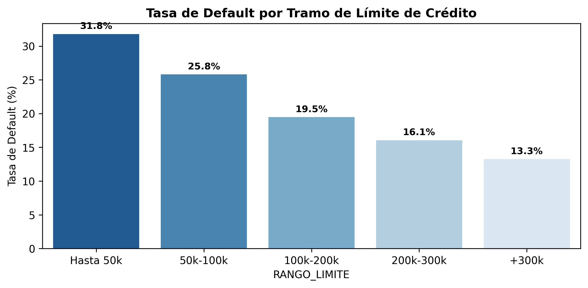
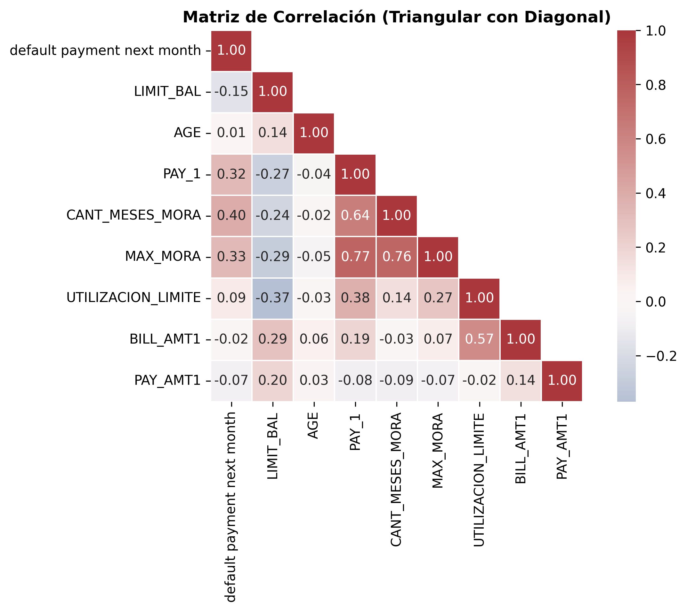
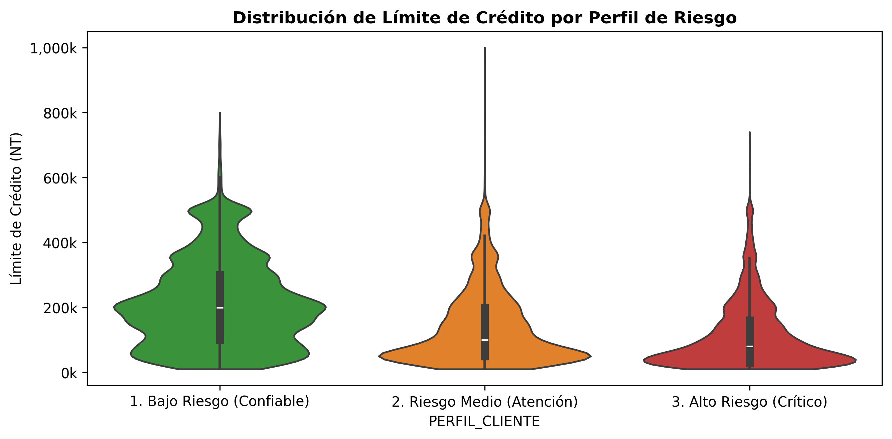
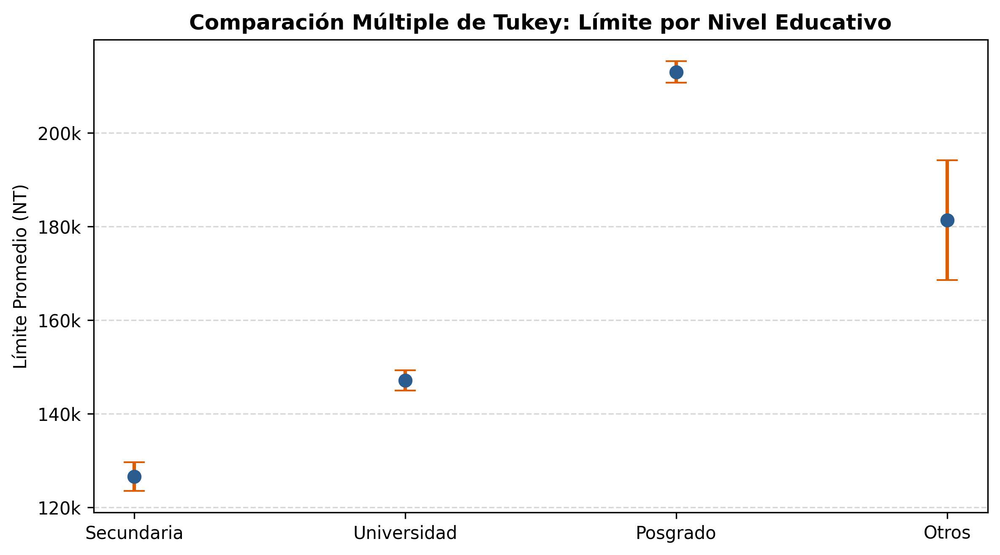
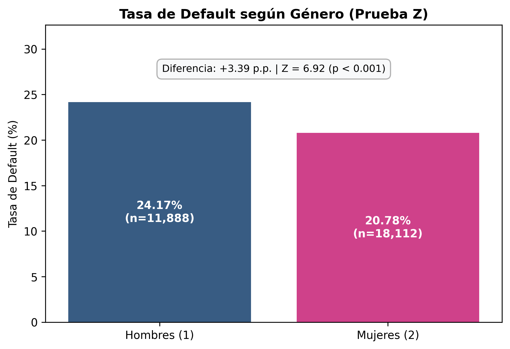
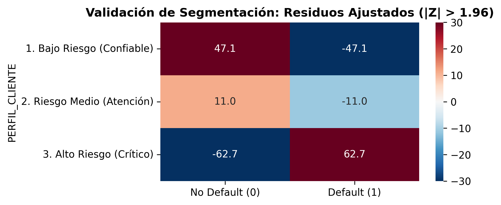
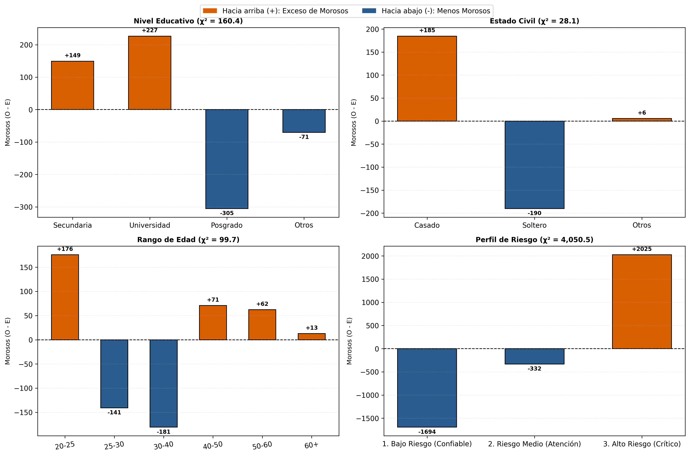
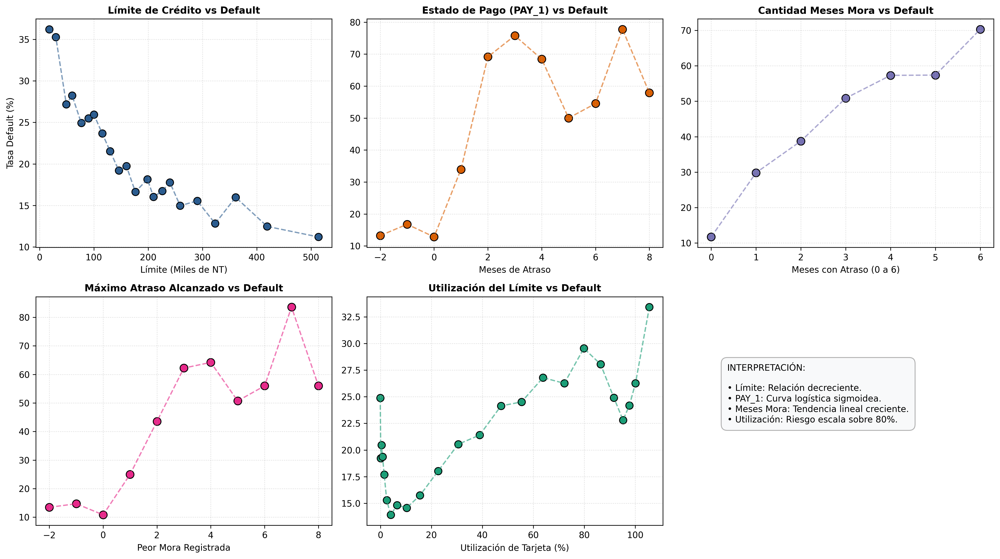

# Credit Card Default & Risk Analysis

Análisis exploratorio avanzado, ingeniería de características financieras, contraste de hipótesis e inferencia estadística rigurosa sobre una cartera de **30.000 clientes bancarios**, orientado a modelar la probabilidad de impago (*default*).

---

## 1. Contexto y Problema de Negocio

El objetivo principal es modelar la probabilidad de que un cliente caiga en **default** en el mes siguiente. En la gestión de carteras de consumo, predecir el impago permite:
* Anticipar pérdidas crediticias y ajustar provisiones de capital.
* Segmentar la cartera para políticas diferenciadas (límites, beneficios o cobranza preventiva).
* Reducir el sesgo en la toma de decisiones crediticias.

> **Diagnóstico del Target (Desbalance de Clases):**  
> La tasa de default observada en la cartera es del **22,12% (6.636 clientes)** frente a un **77,88% (23.364 clientes)** que cumplieron puntualmente. Este desbalance exige evaluar los modelos predictivos mediante métricas robustas como **ROC-AUC, Precision y Recall**, evitando la métrica engañosa de exactitud (*accuracy* simple).

---

## 2. Ingeniería de Variables Financieras y Perfiles de Riesgo

A partir de los registros brutos del banco, se diseñaron variables de comportamiento financiero agregado:

* **Tasa de Utilización del Límite (`UTILIZACION_LIMITE`):** `BILL_AMT1 / LIMIT_BAL`, midiendo el nivel de saturación de la línea de crédito sobre el cupo total.
* **Ratio de Cobertura de Pago (`RATIO_PAGO_1`):** `PAY_AMT1 / BILL_AMT2`, proporción del saldo adeudado del mes previo que fue efectivamente cancelada.
* **Historial Agregado de Retrasos (`CANT_MESES_MORA` y `MAX_MORA`):** Resumen de recurrencia y severidad de mora en la ventana temporal de 6 meses.
* **Segmentación de Perfiles de Riesgo (`PERFIL_CLIENTE`):** Clasificación en *Bajo*, *Medio* y *Alto Riesgo* basada en reglas de comportamiento financiero.

---

## 3. Fase 1: Análisis Exploratorio (EDA) y Alerta Temprana

### A. Relación Inversa entre Límite de Crédito y Morosidad
La política de asignación de límites actúa como un filtro inicial de solvencia patrimonial:

  

> *A menor línea de crédito, mayor riesgo: los clientes con cupo bajo (< 50.000 NT) más que duplican la morosidad del segmento alto (> 300.000 NT), pasando de un 14% a un 32% de default.*

---

### B. Alerta Temprana: Evolución de Facturación vs Pagos (6 Meses)
Al analizar la trayectoria temporal entre Abril y Septiembre, surge una señal de estrés financiero previa al colapso:

  

> **Insight:** Mientras que la deuda facturada (`BILL_AMT`) se mantiene en niveles similares entre ambos grupos, los clientes que caen en default reducen a la mitad sus pagos mensuales (`PAY_AMT`) varios meses antes de ingresar en cesación de pagos formal.

---

### C. Matriz de Correlación y Recencia Temporal
El comportamiento reciente (`PAY_1`) y el acumulado de meses con mora (`CANT_MESES_MORA`) son los predictores con mayor asociación lineal positiva con el impago:

  

---

### D. Distribución y Valores Atípicos por Perfil (Violin Plot)
El gráfico de violín revela la estructura patrimonial de cada segmento de riesgo:

  

* El segmento **Bajo Riesgo** presenta colas largas superiores que alcanzan cupos de hasta **1.000k NT**.
* El segmento **Alto Riesgo** concentra la mayor parte de su masa en cupos mínimos (< 50k NT).

---

## 4. Fase 2: Inferencia Estadística y Pruebas de Hipótesis

Para superar la mera descripción visual y validar formalmente los patrones observados, se aplicaron pruebas de hipótesis estadísticas:

### A. ANOVA y Comparaciones Múltiples de Tukey (Límite vs Educación)
Se contrastó si el banco asigna límites de crédito diferenciados según el nivel de instrucción:
* **ANOVA:** Rechazo contundente de la hipótesis nula (F = 440.3, p < 0.001).
* **Tukey HSD:** Demuestra que las medias poblacionales de límite son estrictamente distintas y no solapan sus intervalos al 95%: **Posgrado (~215k NT) > Universidad (~180k NT) > Secundaria (~125k NT)**.

  

---

### B. Prueba Z de Dos Proporciones: Brecha de Género
Se evaluó si la mayor morosidad observada en hombres respecto a mujeres es estadísticamente significativa:
* **Tasa Hombres:** 24.17% (n = 11,888) | **Tasa Mujeres:** 20.78% (n = 18,112).
* **Diferencia:** +3.39 puntos porcentuales.
* **Estadístico Z:** Z = 6.85 (p < 0.001). Se concluye con 95% de confianza que los hombres presentan una propensión al impago sistemáticamente más alta.

  

---

## 5. Validación Cuantitativa de la Segmentación (Residuos de Haberman)

Para validar empíricamente que la segmentación en 3 perfiles de riesgo realmente separa el default, se calculó la matriz de **Residuos Estandarizados Ajustados de Haberman (Z)** bajo la hipótesis de independencia:

  

* **Bajo Riesgo (Z = -47.1 en Default):** Déficit colosal de 47 desvíos estándar de morosos respecto al azar. Grupo ultra blindado.
* **Alto Riesgo (Z = +62.7 en Default):** Exceso masivo de 62 desvíos estándar de impago. Concentra de forma crítica el riesgo crediticio.
* **Conclusión:** Valores |Z| > 20 confirman una potencia de separación del riesgo matemáticamente irrefutable.

---

## 6. Desvíos Netos de Morosos (Observados - Esperados)

Al analizar las tablas de contingencia mediante pruebas Chi-cuadrado (χ²) y calcular la **diferencia neta exclusiva de clientes morosos (O - E)**, se identifican con precisión las fuentes del riesgo:

  

* **Nivel Educativo:** Secundaria genera +134 morosos de exceso sobre lo esperable por azar; Posgrado produce -165 morosos de déficit (solvencia protectora).
* **Estado Civil:** Los solteros presentan un ligero exceso de mora frente a los casados.
* **Rango de Edad:** Los menores de 25 años y mayores de 60 concentran los desvíos positivos de mora.
* **Perfil de Riesgo:** El grupo de Alto Riesgo concentra +1,800 morosos por encima de lo esperable.

---

## 7. Curvas de Dispersión y Comportamiento Latente (Scatter Plots)

Analizando la probabilidad condicional de default frente a las 5 variables fundamentales:

  

1. **Límite de Crédito:** Relación descendente monótona; a mayor respaldo patrimonial, menor impago.
2. **PAY_1:** Curva logística sigmoidea con un salto crítico de probabilidad a partir de 2 meses de atraso (>60%).
3. **Cantidad de Meses con Mora:** Tendencia lineal creciente; cada mes adicional con retraso deteriora severamente la probabilidad de cobro.
4. **Utilización del Límite:** El riesgo se dispara de forma acelerada al superar el 80% del cupo disponible.

---

## Tecnologías y Librerías Utilizadas
* **Lenguaje:** Python 3.10+
* **Procesamiento de datos:** `pandas`, `numpy`
* **Inferencia Estadística:** `scipy.stats`, `statsmodels`
* **Visualización:** `matplotlib`, `seaborn`
* **Entorno de ejecución:** Google Colab
